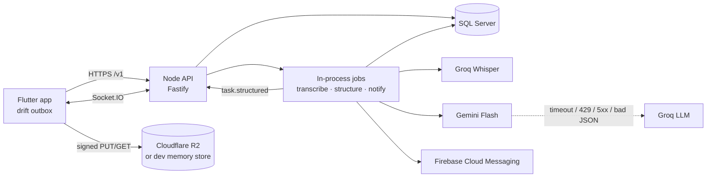
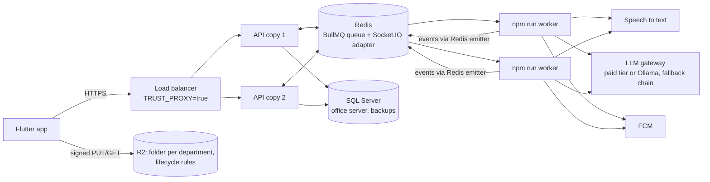

# Architecture

Task Plus Phase 1: a Flutter app talks to one Node.js API over HTTPS and Socket.IO. The API keeps data in SQL Server and hands slow work (speech to text, AI structuring, push) to background jobs, so a sender never waits for AI.

Every outside service sits behind an interface (`LlmProvider`, `SttProvider`, `StorageProvider`, `PushProvider`, `JobQueue`, `Realtime`). Moving from the prototype to production is a settings change, not a code change.

## Prototype mode

`QUEUE_MODE=inline`, `REALTIME_MODE=memory`, AI on free tiers, one API process.

## Production mode

`QUEUE_MODE=bullmq`, `REALTIME_MODE=redis`, two or more API copies behind a load balancer, separate workers, paid AI tier or Ollama on our own hardware.

## How a task moves (spec §11)

1. **Send.** The phone writes the message to its outbox and shows it at once. Then `POST /v1/threads/:id/messages`, with a `clientMsgId` made on the phone.
2. **Save.** One transaction: message, task (`ai_status = pending`), `created` event, thread time. If the same `clientMsgId` arrives again, the first result comes back (200), never a second task.
3. **After commit.** `message.created` goes to the thread, the people in it and the department. A `structure` job is queued, or `transcribe` for a voice note.
4. **Jobs.** Transcribe (voice) → structure: LLM gateway → `ai/validate.ts` (checks, cleans, applies `/` overrides) → update the task → `task.structured` → `notify` (FCM, collapsed per thread).
5. **Failure.** After `JOB_MAX_ATTEMPTS` tries (1 s, 4 s, 16 s apart) the task becomes `needs_review` with the raw text. It is still sent and still notified.
6. **Accept.** A single conditional `UPDATE … OUTPUT … WHERE status = 'Open'`: of two people tapping at once, one wins and the other gets `409 ALREADY_ACCEPTED`.

## Code map

| Concern | Where |
| --- | --- |
| Settings and switches | `server/src/config/env.ts` (the only reader of `process.env`) |
| Providers from settings | `server/src/container.ts` |
| Schema and migrations | `server/src/db/schema.ts`, `server/src/db/migrations/` |
| Access rules | `server/src/modules/access.ts` |
| Routes | `server/src/modules/*/routes.ts` |
| AI | `server/src/ai/` (schema, prompt v1, validate, gateway, adapters) |
| Jobs | `server/src/jobs/queue.ts` (drivers), `handlers.ts` (what jobs do), `server/src/worker.ts` |
| Real time | `server/src/realtime/index.ts` |
| App data | `app/lib/data/` (models, repository, drift outbox) |
| App screens | `app/lib/features/` |

## How to switch to production

| Step | Setting | Notes |
| --- | --- | --- |
| 1. Queue | `QUEUE_MODE=bullmq`, `REDIS_URL=…` | Run `npm run worker` as its own process, 1 or more copies. Jobs that keep failing stay in BullMQ's failed list (the dead-letter list). |
| 2. Real time | `REALTIME_MODE=redis` | Needed as soon as there are two API copies or a worker; the worker emits through Redis. |
| 3. Load balancer | `TRUST_PROXY=true` | Sticky sessions are not needed for Socket.IO with the websocket transport the app uses. |
| 4. AI | `LLM_PRIMARY`, `LLM_FALLBACK`, keys | Paid tier with no training on our data, or `ollama` on our own GPU. |
| 5. Storage | `R2_*` | Without R2 keys the server refuses to start in production. Add lifecycle rules, e.g. delete voice notes after 180 days (D6). |
| 6. Push | `FIREBASE_SERVICE_ACCOUNT_JSON` | Required in production. |
| 7. Secrets | Secrets manager → environment variables | `env.ts` reads only the environment. The server refuses to start if `DEV_FIXED_OTP` is set in production. |
| 8. Database | Office SQL Server with backups | `npm run migrate` with an admin login; the API uses a read/write-only login. Never change tables by hand. |
| 9. Watching | `/healthz`, `/readyz`, `/metrics` | Prometheus counters: `ai_jobs_total{status,provider}`, `ai_latency_ms`, `queue_depth`. Add Sentry for errors. |
| 10. JWT secret rotation | Change `JWT_SECRET`, restart all API copies | Everyone signs in again (access 15 min, refresh 30 days). |

`server/test/production-mode.int.test.ts` runs BullMQ, a worker, Redis real time and two API copies, and passes alongside the prototype-mode suite.
